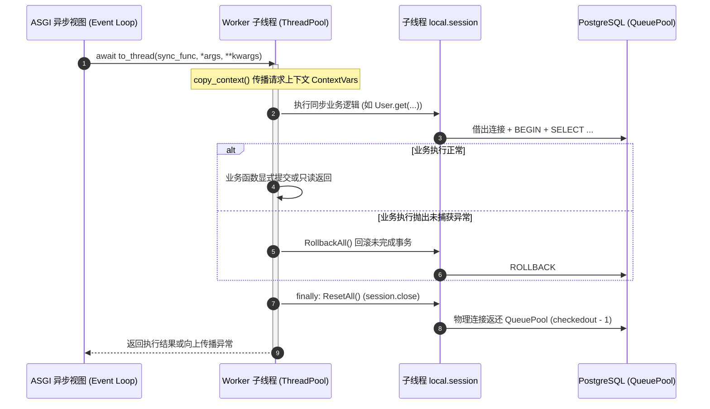

# Spec: ASGI 作用域级 to_thread 与 WebSocket 同步处理器连接生命周期规范说明书

---
类型: spec
状态: approved
创建: 2026-10-10
更新: 2026-10-12
实现针对: docs/sdlc/asgi-db-pool-leak-fix/intent.md
---

## 一、架构演进与前置基线关系

在 ASGI 异步架构下，Uvicorn/Starlette 主事件循环运行在主线程，而同步操作被派发至 `ThreadPoolExecutor` 的 Worker 子线程中执行。

### 1.1 前置提交与已合入基线
本规范基于前序已合入主分支的连接池治理提交构建：
1. **HTTP 同步中间件闭环 (Commit `1f09c23`)**：在 `_call_middleware_method` 中引入 `sync_middleware_wrapper`，在子线程中通过 `try: CommitAll() except: RollbackAll() finally: ResetAll()` 彻底解决了传统 HTTP 同步中间件导致的连接泄露。
2. **同步视图与主请求生命周期 (Commit `1f09c23`)**：在 `_call_function` 内部的 `sync_orm_wrapper` 实现了子线程 `finally: ResetAll()`，并在 `_wrap_traditional_middleware` 请求失败及完成时提供 `ResetAll()`。
3. **协程视图与主事件循环兜底 (Commit `f58e453`)**：在 `call_handler` 中为协程视图补充了非流式响应的 `CommitAll()`、异常 `RollbackAll()` 与 `finally: ResetAll()`，并在 `AsyncDispatcher.__call__` 外层增加了兜底释放。
4. **SQLite 方言防御 (Commit `1f09c23`)**：在 `NamedEngine._create` 中对 SQLite 驱动自动过滤 QueuePool 专有参数。

### 1.2 本次增量交付治理范围
本次变更聚焦于**前序治理未能覆盖的两大盲区**：
- **盲区 1**：异步协程视图中通过 `to_thread` 将耗时同步业务（如数据同步、文件解析、用户画像等）派发到工作线程执行时，子线程持有的 ORM 连接泄露；
- **盲区 2**：同步 WebSocket 处理器在 `run_in_executor` 中执行时，异常断开未执行回滚与连接释放。

### 1.3 核心时序：作用域级 `to_thread` 连接释放闭环



---

## 二、框架核心改造规格定义

### 2.1 方案选型与架构精简（方案 B：轻量化作用域 to_thread）

在历经对全局事件循环执行器替换（`loop.set_default_executor(ORMSafeThreadPoolExecutor)`）的多轮架构评审后，确认全局劫持机制存在侵入性过强、过度接管 asyncio 运行环境生命周期（多 Dispatcher 竞争、loop 切换、在途任务超时排空、weakref 清理及死锁防护等累积 300+ 行非核心代码）的问题。

经项目技术评审决定，系统全面切换为 **方案 B（极简非侵入设计）**：
1. **零全局副作用**：彻底放弃修改全局 `loop.set_default_executor`，不介入 asyncio 内部调度机制。
2. **轻量级显式 `to_thread`**：提供与 `asyncio.to_thread` 签名完全一致的 `to_thread(func, /, *args, **kwargs)` 函数（从 `uliweb` 及 `uliweb.core.SimpleFrame` 导出），内部使用标准 `loop.run_in_executor(None, ctx.run, _sync_worker)` 执行，并在异常时自动调用 `RollbackAll()`、在 `finally` 阶段调用 `ResetAll()`。
3. **向后兼容存根**：保留 `ORMSafeThreadPoolExecutor` 类及 `AsyncDispatcher.safe_executor` 属性存根，确保既有老旧引用不发生 AttributeError。
4. **同步 WebSocket 自动包裹**：在 `AsyncDispatcher._open_websocket` 中，对同步 WebSocket handler 自动注入 `_sync_ws_wrapper`，统一实现异常回滚与 `finally: ResetAll()` 闭环。

### 2.2 作用域级 `to_thread` 安全派发规格

在 [`uliweb/core/SimpleFrame.py`](uliweb/core/SimpleFrame.py) 中实现：

```python
async def to_thread(func, /, *args, **kwargs):
    """在独立工作线程中异步执行同步函数 func，自动管理 ORM 异常回滚与连接释放。

    与 Python 标准库 asyncio.to_thread 签名与 ContextVar 上下文行为完全兼容。
    执行语义：
    - 任务正常完成时，由工作线程 finally 执行 ResetAll() 确保数据库连接归还连接池；
    - 任务发生未捕获异常时，自动执行 RollbackAll() 回滚未完成事务，随后执行 ResetAll()；
    - 事务提交由业务函数自行显式控制（如 CommitAll()），避免静默自动提交只读查询操作。
    """
    from contextvars import copy_context

    loop = asyncio.get_running_loop()
    ctx = copy_context()

    def _sync_worker():
        try:
            return func(*args, **kwargs)
        except Exception:
            try:
                RollbackAll()
            except Exception as rollback_err:
                logger.error(f"[to_thread] RollbackAll failed: {rollback_err}", exc_info=True)
            raise
        finally:
            try:
                ResetAll()
            except Exception as reset_err:
                logger.error(f"[to_thread] ResetAll failed: {reset_err}", exc_info=True)

    return await loop.run_in_executor(None, ctx.run, _sync_worker)
```

- **显式事务控制原则**：任务正常完成时不隐式执行 `CommitAll()`，只读操作不会产生多余的写提交事务；事务提交由业务函数显式控制。
- **ContextVar 透明传播**：通过 `copy_context()` 确保主线程请求上下文（如 `request` / `response` 等 ContextVar）在工作线程中无缝透明可用。
- **顶层模块导出**：在 `uliweb/__init__.py` 中将 `to_thread` 加入 `__all__` 并导出，业务代码推荐直接使用 `from uliweb import to_thread`。

### 2.3 WebSocket 同步处理器 ORM 连接闭环规格

在 [`uliweb/core/SimpleFrame.py`](uliweb/core/SimpleFrame.py) 的 `_open_websocket` 中，针对同步 WebSocket 处理器在 `loop.run_in_executor` 中执行的场景：
- 使用 `asyncio.get_running_loop()` 获取当前运行事件循环；
- 定义 `_sync_ws_wrapper` 包裹 handler 调用：
  - 异常路径：捕获异常后尝试 `RollbackAll()`，若失败使用 `logger.warning("[WebSocket] RollbackAll failed: %s", rollback_err)` 记录警告日志并重新抛出异常；
  - 退出路径：在 `finally` 阶段执行 `ResetAll()`，若失败使用 `logger.warning("[WebSocket] ResetAll failed: %s", reset_err)` 记录警告日志；
  - 确保同步 WebSocket 握手与长连接处理中的 ORM 连接彻底释放。

### 2.4 向后兼容存根与废弃 API 规范

1. **兼容存根**：
   ```python
   class ORMSafeThreadPoolExecutor(ThreadPoolExecutor):
       """向后兼容存根，新代码推荐直接使用 uliweb.to_thread"""
       pass
   ```
   在 `AsyncDispatcher` 中保留属性存根：
   ```python
   @property
   def safe_executor(self):
       """向后兼容属性"""
       return None

   async def to_thread(self, func, *args, **kwargs):
       """在独立工作线程中异步执行同步函数，自动管理 ORM 异常回滚与连接释放"""
       return await to_thread(func, *args, **kwargs)
   ```
2. **废弃 API 替换**：
   将 `SimpleFrame.py` 中遗留的 `asyncio.get_event_loop()` 统一升级为 Python 3.7+ 官方推荐的 `asyncio.get_running_loop()`。

---

## 三、连接池参数容量矩阵设计

| 参数键名 | 旧配置 | 生产推荐配置 | 设计理由与调优依据 |
| :--- | :---: | :---: | :--- |
| `pool_size` | 2 | **10** | 每个 Worker 进程常驻基线连接数，满足单个用户并发请求复用需求。 |
| `max_overflow` | 3 | **15** | 突发并发流量下的溢出连接上限。单 Worker 极限容量为 10 + 15 = 25。 |
| `pool_recycle` | 300 | **300** | 5 分钟（300秒）自动回收并重建闲置连接，防范防火墙或远端超时导致的半开死链。 |
| `pool_pre_ping` | True | **True** | 借出连接前发送探针（`SELECT 1`），遇到断开自动重连，彻底避免断网后报脏连接错误。 |
| `pool_timeout` | - | **30** | 当连接池占满时的最大排队超时时间（秒）。 |

### 进程总容量匹配计算：
- 服务端 PostgreSQL 配置：`max_connections = 150`。
- 生产环境 Uvicorn 进程数：10 个 Worker。
- 进程常驻连接总数：`10 workers * 10 pool_size = 100`（安全处在 150 容量以内）。
- 极限峰值防爆：即使瞬时达到溢出上限，各进程也会以 `pool_timeout=30` 快速回收释放，兼顾吞吐量与 DB 承载力。
