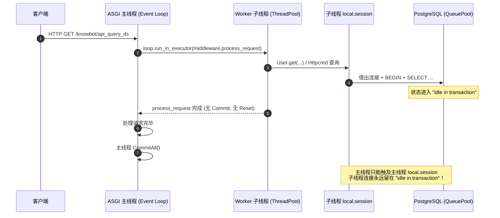
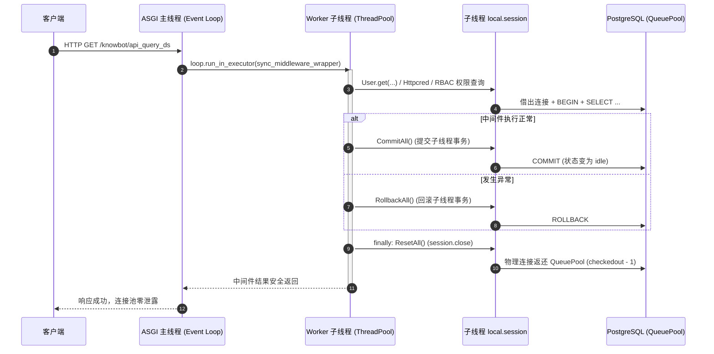

# Spec: ASGI 线程池同步中间件与视图数据库连接生命周期管理与连接池规范说明书

---
类型: spec
状态: approved
创建: 2026-10-10
实现针对: docs/intent/asgi-db-pool-leak-fix/intent.md
---

## 一、系统架构与生命周期时序

在 ASGI 异步架构下，Uvicorn/Starlette 主事件循环运行在主线程，而同步中间件与同步视图被派发至 `ThreadPoolExecutor` 的 Worker 子线程中执行。

### 1.1 修复前：子线程连接丢失闭环（缺陷时序）



### 1.2 修复后：全链路子线程事务与连接收敛（标准时序）



---

## 二、框架代码改造规格定义

### 2.1 `SimpleFrame._call_middleware_method` 包装器规格

在 [`uliweb/core/SimpleFrame.py`](uliweb/core/SimpleFrame.py) 的 `_call_middleware_method` 中，对所有派发至线程池的非协程中间件方法包装闭包 `sync_middleware_wrapper`：

```python
async def _call_middleware_method(self, method, *args):
    """
    统一调用中间件方法，支持异步协程与传统同步函数。
    若为同步函数，通过 run_in_executor 在线程池中执行，并在子线程退出前
    严格执行事务提交 (CommitAll) 与连接归还 (ResetAll)。
    """
    if iscoroutinefunction(method):
        return await method(*args)
    else:
        loop = asyncio.get_running_loop()
        ctx = copy_context()
        
        def sync_middleware_wrapper(m, *m_args):
            try:
                res = m(*m_args)
                try:
                    CommitAll()
                except Exception as commit_err:
                    logger.error(f"[Middleware Transaction] CommitAll failed: {commit_err}", exc_info=True)
                    try:
                        RollbackAll()
                    except Exception as rollback_err:
                        logger.error(f"[Middleware Transaction] RollbackAll failed: {rollback_err}", exc_info=True)
                return res
            except Exception as e:
                try:
                    RollbackAll()
                except Exception as rollback_err:
                    logger.error(f"[Middleware Transaction] RollbackAll failed: {rollback_err}", exc_info=True)
                raise e
            finally:
                try:
                    ResetAll()
                except Exception as reset_err:
                    logger.error(f"[Middleware Transaction] ResetAll failed: {reset_err}", exc_info=True)

        return await loop.run_in_executor(None, ctx.run, sync_middleware_wrapper, method, *args)
```

### 2.2 `SimpleFrame.sync_orm_wrapper` 同步视图释放规格

在 `_call_function` 内部的 `sync_orm_wrapper` 闭包中，在子线程成功执行并 `CommitAll()` 或失败 `RollbackAll()` 之后，必须在 `finally` 阶段触发 `ResetAll()`：

```python
def sync_orm_wrapper(func, *args, **kwargs):
    try:
        res = func(*args, **kwargs)
        try:
            CommitAll()
        except Exception as commit_err:
            logger.error(f"[View Transaction] CommitAll failed: {commit_err}", exc_info=True)
        return res
    except Exception as e:
        try:
            RollbackAll()
        except Exception as rollback_err:
            logger.error(f"[View Transaction] RollbackAll failed: {rollback_err}", exc_info=True)
        raise e
    finally:
        try:
            ResetAll()
        except Exception as reset_err:
            logger.error(f"[View Transaction] ResetAll failed: {reset_err}", exc_info=True)
```

### 2.3 `_wrap_traditional_middleware` 请求主生命周期释放规格

在 ASGI 顶层中间件栈派发循环中，由于响应体已在 `await response(scope, receive, send)` 阶段完全序列化并输出至 ASGI 网络层，无论请求成功还是抛出未捕获异常：
- 异常路径：先 `RollbackAll()`，并在最外层 `finally` 中执行 `ResetAll()`。
- 成功路径：在 `CommitAll()`（失败则回滚）后，在整个请求周期的最外层 `finally` 块中执行 `ResetAll()`，安全释放物理连接，且不影响响应序列化。

### 2.4 `NamedEngine._create` SQLite 驱动过滤规格

针对 SQLite 连接字符串（`sqlite://`），SQLAlchemy 使用 `NullPool` 或 `SingletonThreadPool`，若传入 `QueuePool` 的参数（`pool_size`, `max_overflow`, `pool_timeout`, `pool_recycle`, `pool_pre_ping`）会抛出类型错误。在 [`uliweb/orm/__init__.py`](uliweb/orm/__init__.py) 中使用 `make_url(conn_str).drivername.startswith('sqlite')` 进行准确方言识别并过滤，解析异常时记录警告日志：

```python
if conn_str:
    try:
        is_sqlite = make_url(conn_str).drivername.startswith('sqlite')
    except Exception:
        log.warning(f"Failed to parse connection string with make_url, falling back to prefix match: {conn_str}")
        is_sqlite = conn_str.lower().startswith('sqlite')
    if is_sqlite and 'poolclass' not in args:
        for pool_arg in ('pool_size', 'max_overflow', 'pool_timeout', 'pool_recycle', 'pool_pre_ping'):
            args.pop(pool_arg, None)
```

---

## 三、连接池参数容量矩阵设计

| 参数键名 | 旧配置 | 生产推荐配置 | 设计理由与调优依据 |
| :--- | :---: | :---: | :--- |
| `pool_size` | 2 | **10** | 每个 Worker 进程常驻基线连接数，满足单个用户并发请求复用需求。 |
| `max_overflow` | 3 | **15** | 突发并发流量下的溢出连接上限。单 Worker 极限容量为 10 + 15 = 25。 |
| `pool_recycle` | 300 | **300** | 5 分钟（300秒）自动回收并重建闲置连接，防范防火墙或远端超时导致的半开死链。 |
| `pool_pre_ping` | True | **True** | 借出连接前发送探针（`SELECT 1`），遇到断开自动重连，彻底避免断网后报脏连接错误。 |
| `pool_timeout` | - | **30** | 当连接池占满时的最大排队超时时间（秒）。 |

### 进程总容量匹配计算：
- 服务端 PostgreSQL 配置：`max_connections = 150`。
- 生产环境 Uvicorn 进程数：10 个 Worker。
- 进程常驻连接总数：`10 workers * 10 pool_size = 100`（安全处在 150 容量以内）。
- 极限峰值防爆：即使瞬时达到溢出上限，各进程也会以 `pool_timeout=30` 快速回收释放，兼顾吞吐量与 DB 承载力。
